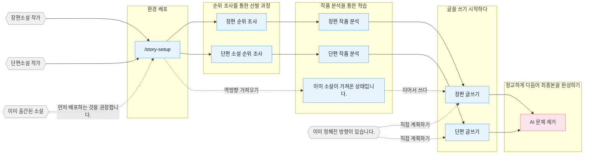

<p align="center">
  
</p>

<h1 align="center">Oh Story</h1>

<p align="center">
  <b>웹소설 집필 스킬 묶음: 순위 조사, 작품 분석, 집필, AI 문체 제거, 표지 제작까지 하나의 흐름으로, 현재 사용하는 코딩 에이전트에 설치합니다.</b>
</p>

<p align="center">
  <a href="https://zenstory.ai/zh/oh-story"> <b> 프로젝트 홈페이지 </b> </a>
  &nbsp;·&nbsp;
  <a href="https://app.zenstory.ai/?utm_source=gh-oh-story&utm_medium=readme"><b>온라인 집필 작업 공간</b></a>
  &nbsp;·&nbsp;
  <a href="#安装"><b>설치</b></a>
  &nbsp;·&nbsp;
  <a href="#常见问题"><b>자주 묻는 질문</b></a>
  &nbsp;·&nbsp;
  <a href="README_EN.md"><b>영어판의 한국어 번역</b></a>
</p>

<p align="center">
  <a href="https://github.com/zenstory-ai/oh-story-claudecode/stargazers"></a>
  <a href="https://github.com/zenstory-ai/oh-story-claudecode/releases/latest"></a>
  
  <a href="./LICENSE"></a>
</p>

<p align="center">
  <a href="https://t.me/ohstoryclaudecode"></a>
  <a href="https://github.com/zenstory-ai/oh-story-claudecode/discussions"></a>
</p>

<video src="https://github.com/user-attachments/assets/8f9cc11b-1fb8-4cc5-a084-e0deb05ec791" controls muted playsinline width="100%"></video>

<a id="这是什么"></a>
새 프로젝트의 폴더·파일명은 한국어입니다: `설정/`, `개요/`, `본문/`, `추적/`. 기존 중국어 프로젝트는 [원본 보존 전환 안내](skills/story-setup/references/korean-project-paths.md)를 따르세요. 과거 실행 증거는 원본 경로를 유지하며, [한국어 예제](demo/ko/README.md)는 새 경로로 제공합니다.

## 소개

Oh Story는 장편 및 단편 웹소설의 전 과정을 포괄합니다: **순위 조사를 통한 소재 선정 → 인기 작품 분석 → 개요 작성 및 본문 집필 → AI 문체 제거 → 표지 이미지 제작**.
14개의 스킬을 현재 사용하는 코딩 에이전트에 설치하는 방식입니다. 집필에는 해당 에이전트의 모델을 사용하므로 GPU나 별도의 모델 설정이 필요하지 않습니다.

- **파일 시스템을 기억으로 활용하기** — 설정, 개요, 본문, 추적 정보를 각각 독립적으로 관리하며, 컨텍스트를 압축하거나 세션을 변경한 후에도 파일을 통해 현재 진행 상황, 복선, 미완료된 작업 내용을 복원할 수 있습니다.
- **결정적 검사와 검증 관문** — 장편 집필 전에 상세 개요와 추적 정보를 검사하고, 집필 후에는 본문 잘림, 개발 용어의 혼입, 흔한 AI 문장 패턴을 검사합니다. 훅을 지원하는 호스트는 해당 검사를 자동으로 실행하고, 그 밖의 환경에서는 스킬의 절차에 따라 실행합니다.
- **7종의 코딩 에이전트와 호환 가능** — Claude Code, Codex CLI, Google Antigravity, OpenCode, ZCode, OpenClaw, Reasonix; 프로젝트 파일을 읽을 수 있는 일반적인 웹 AI/에이전트 환경에서도 사용할 수 있습니다.
- **대상 플랫폼** — 치뎬, 판체, 진장, 치마오, 즈후 옌옌 등 장편·단편 플랫폼.

> **서사 공식 = 예측 가능한 감정적 만족**

먼저 **순위 조사**로 소재, 인물 설정, 접근점을 찾고, **작품 분석**으로 전개 속도와 줄거리 소재를 분석한 뒤, 훅·쾌감·기대감을 활용해 자신만의 이야기를 구성합니다.
설정 내용, 본문, 그리고 추적 정보는 각각 파일에 저장되며, 작가가 방향을 결정한 후 에이전트가 확인된 계획에 따라 작업을 진행합니다.

<a id="安装"></a>
## 설치

```bash
npx skills add zenstory-ai/oh-story-claudecode -y -g
```

`-g`를 사용하면 전체 디렉터리에서 사용할 수 있습니다; `-g`을 제거하면 현재 디렉터리에만 설치됩니다. **업데이트할 때는 동일한 명령을 다시 실행하기만 하면 됩니다.**

에이전트에게 다음과 같이 요청할 수도 있습니다. GitHub 저장소나 스킬 가져오기를 지원하는 플랫폼에서 사용할 수 있습니다. WorkBuddy의 예시는 커뮤니티의 [새 작품 시작 실습](https://zhuanlan.zhihu.com/p/2087452622655592204)을 참고하세요.

```
이 https://github.com/zenstory-ai/oh-story-claudecode 스킬을 설치하세요.
```

설치 후 집필 프로젝트의 루트에서 `/story-setup`(Codex는 `$story-setup`)을 실행해 현재 호스트가 지원하는 훅·에이전트·참조 자료를 배포하고, **새 세션을 시작합니다**.

[ClawHub](https://clawhub.ai/)을 통해 찾아볼 수도 있습니다. 이 저장소의 공개 범위에 대해서는 [ClawHub 공개 목록](.clawhub/publish.json)을 참조하십시오.

> 각 에이전트의 배포 차이점, 알려진 제한 사항 및 설치 관련 문제점(Windows `ENOENT`, Antigravity `agy -p`, 디렉터리 잔여 파일 등)은 **[각 코딩 에이전트의 배포 및 설치 관련 문제점](docs/hosts.md)**를 참조하십시오.
> 버전 및 변경 사항은 [CHANGELOG.md](CHANGELOG.md)과 [Releases](https://github.com/zenstory-ai/oh-story-claudecode/releases)를 참조하십시오. 기존 프로젝트의 업데이트 방법은 [업그레이드 가이드](skills/story-setup/UPGRADING.md)을 확인하십시오.

<a id="看看它的输出"></a>
## 실제 산출물

아래는 스킬의 실제 산출물과 AI 문체 검사를 위해 별도로 만든 테스트 예시입니다. 전체 파일은 **[demo/](demo/README.md)**에 있습니다.

<a id="续写状态卡把当前状态写进文件"></a>
### 이어쓰기 상태 카드: 현재 상태를 파일에 기록

아래 작품은 프로젝트 제작자의 장편소설입니다. `/story-import`로 이미 발표한 첫 20장을 역분석하여 이어 쓸 수 있는 프로젝트를 만들었습니다.
아래는 **21장을 쓰기 전**의 상태 카드입니다. `/story-long-write`는 `추적/문맥.md`에서 연속성 요약을 읽습니다. 고정된 7개 항목, 최대 12KiB이며, 주 세션이 이번 장과 관련된 상태만 추려 집필자에게 전달합니다. 카드 전문을 집필자 프롬프트에 넣지는 않습니다. 상세 개요, 관련 설정, 필요한 인물 카드는 작업에 맞춰 별도로 읽습니다.

```markdown
## 현재 위치
- 현재 장: 제20장   권: 제1권·군사 홍보 정비   이야기 시간: 《여원》 조회 수가 1억을 넘긴 다음 날

## 장기적인 제약
- 군사 홍보에서의 쾌감 포인트는 작품의 효과, 확산 데이터, 그리고 대중의 반응을 통해 실현되어야 하며, 단순히 시스템을 통한 방송만으로는 충분하지 않습니다.
- 종가가에 대한 미공개 군부 양성 계획은 작가만 아는 진실이며, 본문에서 밝히기 전에 독자가 이미 아는 사실로 취급하면 안 됩니다.

## 진행 중인 복선
- F016｜종가가는 평범한 군사 신문 실습생이 아니며 군부 집안 배경은 아직 전부 공개되지 않았다｜제7장에 배치｜회수 장 미정｜높음
- F049｜오위에게 소란·시비 행위에 대한 공소 통지가 왔으나 최종 법적 결과는 아직 나오지 않았다｜제18장에 배치｜회수 장 미정｜높음
- F054｜한 노병이 강신을 집으로 초대해 옛이야기를 들려주려 하며, 이후 창작의 계기가 된다｜제20장에 배치｜회수 장 미정｜높음

## 다음 장에서 이행할 약속
- 먼저 제21장 상세 개요를 보완한 뒤, 노병의 초대·새 노래의 반주·피아노 능력을 이어 갑니다.
```

**작가만 아는 진실과 독자가 이미 아는 사실을 나누어 기록**하여, 인물이 답을 너무 일찍 아는지, 복선이 이미 드러났는지를 검사합니다.
전체 파일: [`demo/长篇/.../追踪/上下文.md`](demo/长篇/让你管账号，你高燃混剪炸全网/追踪/上下文.md)

<a id="续写第-21-章从门禁到回写一条链走完"></a>
### 제21장 이어쓰기: 사전 검사부터 상태 반영까지

위 비디오에는 바로 이 부분이 담겨 있습니다. `/story-long-write 제21장 집필`가 실제 대화 중에 생성한 내용과 각 검사 항목들입니다:

```text
상세 개요  상세개요_제021장.md             추적 상태에 ‘제21장 상세 개요 없음’이 있어 개요부터 보완: 단위 L1-03, 목표 감정, 이번 장의 대가, 완결 상태, 사건 지점 10개의 4열 표(필요하면 해상도 열 추가)
장 검사    storyctl.py chapter check   ready · 글자 수 2068 / 목표 2300
             ├ check-ai-patterns.js     감지 0건
             ├ check-degeneration.js    감지 0건
             └ normalize-punctuation    감지 0건
추적 제출  storyctl.py chapter commit  tracking_committed=true · state_revision 0 → 1
파생 문서  tracking_commit.py check    문맥.md / 복선.md / 인물상태/ / 시간선/ / 장별기록/ 모두 state에서 재생성되며 내용이 정확히 일치
```

본문을 작성하기 전에 먼저 상세 개요와 추적 내용을 확인해야 합니다. 상세 개요가 구조적으로 검토를 통과한 후에는 `narrative-writer`이 두 차례에 나누어 본문을 작성합니다. 각 장을 제출하기 전에는 사실관계와 복선 내용을 다시 한 번 확인해야 하며, 매일 업데이트되는 내용 중에서는 각 장별로 검토하지 않은 경우에는 배치가 끝날 때 일괄적으로 확인합니다. 읽는 느낌이 추가적으로 검토가 필요한 경우에는 별도의 심사 과정을 거칩니다. 최종 제출 전에는 결정적인 사항들을 확인하는 스크립트와 `chapter check`을 반드시 실행해야 합니다.

제출 후에는 도구가 `_tracking-state.json`에서 추적 상태 전체를 다시 렌더링합니다. **파생 파일을 직접 수정하면 `check`가 거부합니다**.
위 상태 카드와 비교하면 실제 반영 내용은 다음과 같습니다(원본 항목명과 내용을 한국어로 옮김). 일부만 발췌했으며, 같은 배치에서 갱신된 최근 세 장의 요약과 인물 상태는 생략했습니다.

```diff
 ## 현재 위치
-- 현재 장: 제20장   장면: 로켓군 문공단, 종가가가 노병의 서예 선물을 전한 뒤
+- 현재 장: 제21장   장면: 로켓군 문공단 사무실, 강신이 담수의의 주소 답장을 받은 뒤
 ## 활성 복선
-- F054｜노병이 강신을 초대해 옛이야기를 들려주려 함. 후속 창작의 계기｜제20장 설치｜회수 미정｜높음
+- F054｜담수의가 이웃 도시의 주소를 보냄. 강신은 다음 날 방문하기로 함｜제20장 설치｜제22장 회수｜높음
+- F057｜담수의가 50년간 이야기했지만 아무도 끝까지 듣지 못한 이야기. 내용 미공개｜제21장 설치｜제22장 회수｜높음
+- F058｜과제 3: 이별 주제 작품, 개방 행사 당일 인기 1천만 이상, 기한 14일｜제21장 설치｜제27장 회수｜높음
 ## 다음 장 약속
-- 제21장 상세 개요부터 보완하고 노병의 초대, 신곡 반주, 피아노 능력을 이어 간다.
+- 강신은 주박삼에게 외출 허가를 받아 이웃 도시에서 담수의의 이야기를 끝까지 듣고 녹음한다. F057을 공개한다.
 ## 연속성 위험
-- 제21장 상세 개요가 없어 본문을 바로 쓸 수 없다.
+- 담수의 이야기의 작가용 진실은 후보(E015)다. 작가는 제22장 상세 개요 전에 바꿀 수 있으며, 공개 전에는 독자가 아는 사실로 취급하지 않는다.
```

새 인물 담수의에게는 설정 카드와 인물 상태 파일이 생겼습니다. 그가 “50년간 이야기했지만 누구도 끝까지 듣지 않은” 이야기의 진실 후보(E015)는 `시간선/작가용진실.md`에 미공개로 기록합니다. `독자가아는사실.md`에는 강신이 실제로 본 그 한 문장만 기록합니다. 더 이상 유효하지 않은 위험은 `장별기록/제021장.md`의 “이번 장에서 종료한 항목”에 기록하므로 **상태가 기록 없이 사라지지 않습니다**.

완성본: [`正文/第021章_离别怎么会开花.md`](demo/长篇/让你管账号，你高燃混剪炸全网/正文/第021章_离别怎么会开花.md)
· [`大纲/细纲_第021章.md`](demo/长篇/让你管账号，你高燃混剪炸全网/大纲/细纲_第021章.md)
· [`设定/角色/谭守义.md`](demo/长篇/让你管账号，你高燃混剪炸全网/设定/角色/谭守义.md)
· [`追踪/逐章记录/第021章.md`](demo/长篇/让你管账号，你高燃混剪炸全网/追踪/逐章记录/第021章.md)


<a id="拆文报告评分要给得出理由"></a>
### 작품 분석 보고서: 점수를 매길 때는 그 이유를 명확히 제시해야 합니다.

`/story-long-analyze`로 《반룡》의 첫 23장(약 6.2만 자, 분석 자료로만 사용한 치뎬의 고전)을 분석하고, 판체 남성향 성장물 독자의 취향을 기준으로 점수를 매겼습니다.

| 평가 항목 | 점수 | 설명(발췌) |
|------|------|------|
| 도입부 훅 | 2 | 첫 500자는 지리적 배경과 아침 훈련의 군상 묘사뿐이며, 미스터리·갈등·대조가 없습니다. 평민이 노력해 성공한다는 이야기로 서서히 몰입을 쌓습니다. 몰입 기반은 탄탄하지만 즉시 끌어당기는 힘은 약합니다. |
| 주인공 조형 | 4 | 이름을 60번째 문단에서야 밝히고 타인의 감탄으로 소개합니다. 몰락한 귀족과 여섯 살 신동이라는 대조로 인물상을 세웁니다. 첫 세 장에서 가장 뛰어난 부분입니다. |
| 쾌감 포인트 설계 | 1 | 첫 세 장에는 전통적인 쾌감 포인트가 없습니다. 특수 능력이 등장하는 제18장까지 카타르시스를 의도적으로 늦추고, 누적된 몰입의 효과에 기대는 구조입니다. |

> **종합적으로 보면**, 세 장은 “인물 설정을 탄탄히 하고 쾌감 포인트를 전혀 주지 않는” 극단적인 구조입니다. 이대로 그대로 따라한다면 판체 독자들을 멀어지게 할 것입니다.
> 다만 스승의 설명으로 설정을 전달하기, 이름을 늦게 공개하기, 감정을 신체 반응으로 드러내기 같은 개별 기법은 충분히 재사용할 수 있습니다.

전체 보고서: [`demo/拆文库/盘龙/拆文报告.md`](demo/拆文库/盘龙/拆文报告.md)

<a id="短篇拆文把自己的作品拆成可复用的模块"></a>
### 단편 작품 분석: 자신의 작품을 재사용 가능한 모듈들로 나누어 분석하기

`/story-short-analyze`로 작가 자신의 약 8,500자 단편 《한때 사랑을 감추었다》를 분석했습니다. 이별 뒤 뒤늦게 매달리는 후회물과 죽음을 가장한 잠적을 결합한 작품입니다.
54개의 사건 노드와 11가지 집필 기법을 추출했습니다. 각 노드는 원문에 연결하고 감정 유형과 강도(−9~+9)를 표시합니다.

| 원문 | 뽑아낸 구조 |
|---|---|
| “호 총, 아직 심무월 모자를 집 안으로 들이지 않을 생각인가요?” <br> “필요 없어요. 그냥 사생아일 뿐이니까.” <br> 문을 열려고 하던 참에 그 말을 듣고 손이 공중에서 멈추었다. | **N1 출입구에서 “사생아에 불과하다”는 말을 우연히 들었다** <br> 유형{정보} · 감정{충격}{−7} <br> 전개 방식{처음부터 갈등이 발생하고 정보에 차이가 존재한다} |
| 호정욱은 나를 사랑하지 않는다. <br> 나는 조용히 손을 빼냈다. <br> 이제는 자신의 집착을 버려야 할 때다. | **N2 상대방에게서 사랑이 없다는 것을 깨닫고, 집착을 포기하기로 결심한다** <br> 타입 {감정} · 감정{슬픔}{−5} |

같은 산출물의 `집필기법.md`는 원작이 선택한 시점의 대가도 직접 짚습니다.

> **POV의 대가**: 남주인공의 변화 과정이 제대로 보여지지 않았으며, N47의 내면 독백은 “오래전에 용서했다”, “밤잠을 이룰 수 없다”, “깊이 사랑한다”는 내용만 집중적으로 담겨 있었다.
> 직접 설명하는 비중이 보여주는 비중보다 큽니다(tell > show). 이는 1인칭 후회물에서 흔한 문제입니다.

후속 단계인 `/story-short-write`는 보고서, 사건 노드, 집필 기법, 원문을 함께 참고해 새 작품을 구상합니다.
전체 결과: [`demo/拆文库/曾将爱意私藏/`](demo/拆文库/曾将爱意私藏/)

<a id="去-ai-味逐条匹配已知句式"></a>
### AI 문체 제거: 알려진 문장 패턴에 따라 일일이 매칭하기

`/story-deslop`의 로컬 검사는 글쓰기용 린트입니다. 알려진 문장 패턴을 하나씩 대조합니다.
행 번호, 감지된 구절, 수정 방향을 제시합니다. 인위적으로 만든 AI 문체 예시에서는 8곳이 감지되었고, 그중 7곳은 blocking 판정이었습니다.

```text
改前.md:7:20     [blocking] em-dash             (么叫做命运的安排——不是巧合，而是一)
改前.md:7:22     [blocking] not-is-comparison   (不是巧合，而是一种冥冥之中的注定)
改前.md:11:1     [blocking] negation-parade     (没有犹豫，没有生涩，)
改前.md:19:3     [blocking] voice-contrast      (声音不大，却)
改前.md:21:2     [blocking] not-is-comparison   (不是一次简单的弹奏，而是一场蓄谋已久的惊艳亮相)
改前.md:3:1      [advisory] cliche-density-tic  (仿佛 一丝 深吸一口气 缓缓 微微)
```

제21장 본문의 같은 장면을 같은 검사기로 확인하면 **감지 0건, exit 0**입니다.
두 문장의 글자 수는 거의 같지만, 차이점은 수정 전에는 추상적인 표현을 사용하여 독자에게 사물의 성격을 규정해 주었던 반면, 수정 후에는 같은 사건을 실제로 일어나는 행동과 사물을 통해 표현하고 있다는 점입니다.

전체 전후 대조와 8건의 감지 결과: **[demo/AI 문체 대조](demo/去AI味对照/README.md)**

<a id="本地写作工作台与封面"></a>
### 로컬 집필 작업 공간과 표지

`/story dashboard`(Codex의 경우 `$story dashboard` 사용)을 실행하여 로컬 워크벤치를 열고, 작품 분석 라이브러리와 장단편 프로젝트 파일 트리를 탐색할 수 있습니다. 검색, Markdown 미리보기, 텍스트 편집, 충돌 방지 기능을 갖춘 저장 및 삭제 확인 기능도 지원됩니다. 상단 바에서는 밝은 색상과 어두운 색상을 전환할 수 있으며, 이 서비스는 `127.0.0.1`만을 청취하므로 소설 내용은 업로드되지 않습니다.

| 작업대 | `/story-cover`로 생성된 표지 이미지 |
|---|---|
|  |  |

<a id="安装后的第一条请求"></a>
## 설치 후 첫 요청

현재 진행 중인 작업 중 하나를 선택한 후, 〈대체 내용〉을 자신의 정보로 바꾸세요.

1. **새 작품 시작하기**
   > 〈장르/소재〉의 새 작품을 시작하고 싶습니다. 제공한 자료에서 확정된 사실과 미결 문제를 먼저 구분해 주세요. 범위가 명확한 도입부만 기획하고, 핵심 갈등, 시점·정보 공개의 한계, 첫 세 장의 변화, 미결 항목을 제시해 주세요. 본문을 자동으로 쓰지 말고, 소재 선택·인물 동기·장기 방향은 제가 확인할 수 있게 남겨 주세요.
2. **기존 원고를 가져오기**
   > 이 원고를 이어 쓸 수 있는 프로젝트로 정리해 주세요. 제1~〈N〉장은 완성되었고 〈파일명〉은 제〈N+1〉장의 미완성 원고입니다. 원문을 보존하고 완성된 장을 덮어쓰지 않으며, 미완성 원고를 완성 장으로 세지 말아 주세요. 추론한 설정은 확인 대기 항목으로 따로 정리해 주세요. 먼저 인식한 범위, 재구성한 사실, 충돌·모호함, 제가 결정할 사항을 검토용으로 제시하고, 아직 이어 쓰지는 마세요.
3. **만족스럽지 않은 본문을 수정하기**
   > 이 부분은 〈공허함/반복/과도한 설명〉이 느껴집니다. 구체적인 읽기 문제를 먼저 짚고, 이야기의 사실·인물이 아는 정보·미공개 정보의 경계를 유지해 주세요. 이 부분의 수정 제안과 전후 대조, 이유만 제시하고 작품 전체를 다시 쓰지는 마세요. 제안의 채택 여부는 제가 결정합니다.

<a id="流程总览"></a>
## 프로세스 개요

순위 조사와 작품 분석은 필요에 따라 선택합니다. 바로 구조나 개요를 논의해도 되지만, 본문을 실제 파일에 쓰기 전에는 프로젝트 배포를 완료해야 합니다.



## 스킬

**이 몇 가지만 사용해도 책을 쓰는 데 충분합니다**: 한 번 `story-setup`를 설치한 후, 장편 글쓰기에는 `story-long-write`을, 단편 글쓰기에는 `story-short-write`를 사용하고, 작성이 끝난 후에는 `story-deslop`를 사용하여 AI 문체 제거를 수행하세요. 어떤 것을 사용해야 할지 확신이 서지 않는다면 `/story`를 사용하고 한 마디를 더 추가하시면 됩니다.

| 스킬 | 호출 | 설명 |
|:------|:-----|:-----|
| `story-setup` | `/story-setup` `$story-setup` `/准备写书` | 환경 배포 · Claude/Antigravity/OpenCode/Codex/ZCode/OpenClaw/Reasonix + generic(기존 설정과 안전하게 병합) |
| `story` | `/story` `$story` `/story dashboard` | 툴박스 라우팅 · 모호한 의도와 작가의 습관에 따른 요청 분배 + 로컬 작품 분석/프로젝트 대시보드 |
| `story-long-write` | `/story-long-write` `/写长篇` | 장편 글쓰기 · 개요 작성, 등장인물 설정, 본문 작성, 작가의 선호 사항 관리 |
| `story-short-write` | `/story-short-write` `/写短篇` | 단편 글쓰기 · 감정 설계, 반전 구상, 완성도 높은 원고 작성, 작가의 선호 사항 관리 |
| `story-deslop` | `/story-deslop` `/去AI味` | AI 문체 제거 · AI가 작성한 흔적을 감지하고 제거하기 |

**추가 기능**: 비교 대상 작품 분석, 순위 조사, 기존 원고 가져오기, 다각도 검토, 게시 자료 정리, 표지는 필요할 때 사용합니다.

| 스킬 | 호출 | 설명 |
|:------|:-----|:-----|
| `story-long-analyze` | `/story-long-analyze` `/长篇拆文` | 장편 작품 분석 · 황금 삼장, 쾌감 포인트 설계, 리듬 분석 |
| `story-long-scan` | `/story-long-scan` `/长篇扫榜` | 장편 순위 조사 · 치뎬/판체/진장 시장 동향 |
| `story-short-analyze` | `/story-short-analyze` `/短篇拆文` | 단편 작품 분석 · 줄거리 핵심, 구조 분석, 감정선, 반전 구성, 글쓰기 기법, 공감 요소 분석 |
| `story-short-scan` | `/story-short-scan` `/短篇扫榜` | 단편 순위 조사 · 즈후 옌옌/판체 단편 트렌드 데이터 |
| `story-import` | `/story-import` `/导入小说` | 역방향 가져오기 · 기존 소설을 표준 프로젝트 구조로 역분석하기 |
| `story-review` | `/story-review` `/审查` | 다각도 검토 · full / lean / solo 모드와 판체·치뎬·즈후 평가 기준 |
| `story-publish` | `/story-publish` | 게시 준비 · 기존 설정과 개요로 작품 등록 자료(제목·소개·태그)를 정리하며, 현재 판체 지원 |
| `story-cover` | `/story-cover` `/封面` | 표지 프롬프트 또는 완성 이미지 · GPT-Image-2로 이미지 생성(Codex 내장 사용량 또는 API 대체 경로) |
| `browser-cdp` | `/browser-cdp` | 브라우저 제어 · CDP로 로그인 상태를 재사용해 데이터 수집 |

> `story-deslop`의 로컬 검사는 린트 작업으로 이루어지며, ‘blocking’ 기능은 결정적인 문법 오류나 구두점 문제에만 적용되고, 그 외의 경우는 읽는 느낌에 따라 판단됩니다. 주작과 같은 외부 검사 도구들은 자가 테스트를 위한 참고 자료로만 사용되며, 인간의 직접적인 읽는 느낌을 대체할 수는 없습니다.

자연어 역시 동일하게 작동합니다:
- “새 작품을 시작하고 싶어요” → `story-long-write`
- “판체 게시 자료를 정리해 주세요” → `story-publish`
- “이 글은 너무 AI스럽네요” → `story-deslop`
- “내 책을 여기로 옮겨주세요” → `story-import`
- 「작업대 열기」 → `story dashboard`(로컬에서 작품 분석 자료를 브라우징하거나 글쓰기 프로젝트를 진행할 수 있으며, 간단한 편집도 가능)
- “제 집필 습관을 기억해 주세요” → `story`가 해당 집필 스킬로 연결하고, 그 스킬이 작가 기억을 관리합니다(발언 원문 근거, 확인 대기, 충돌 시 대체).
- “심지는 지금 어떤 상태인가요?” → 프로젝트 자료를 검색하고, 호스트가 지원하면 `story-explorer`에 맡깁니다.

<a id="工作原理"></a>
## 작동 원리

파일, 전문 에이전트 및 훅들은 모두 작성 과정을 지원합니다. 자세한 내용은 **[작동 원리: 에이전트, 훅 및 프로젝트 구조](docs/architecture.md)**을 참조하십시오.

**① 파일 시스템을 기억으로 활용하기** — 수십만 자에 이르는 장편 작품의 경우, 설정, 개요, 본문, 추적 내용을 각각 독립된 디렉터리로 나누어 관리한다.
대화는 단지 창작하는 역할만을 하며, 기억하는 역할은 하지 않습니다. `추적/` 아래에 있는 `_tracking-state.json`만이 유일하게 구조화되어 있으며 권위가 있습니다.
이를 통해 상황 설명 카드, 복선 보기, 캐릭터 상태 정보, 그리고 ‘작가의 진실 / 독자가 이미 알고 있는 사실’이라는 두 가지 시간선이 생성됩니다.

**② 7개의 전문 에이전트 역할 분담** — 스토리 아키텍트는 아키텍처 설계를 담당하고, 내러티브 작가는 본문을 작성하며, 일관성 확인자는 내용의 일관성을 검사합니다.
나머지는 인물 설계, 자료 조사, 프로젝트 검색, 장별 추출을 담당합니다. 프로젝트 에이전트를 지원하는 호스트에서는 `/story-setup`으로 배포한 뒤 **새 세션을 시작합니다**. 지원하지 않는 환경에서는 주 세션이 해당 작업을 수행합니다.

**③ 집필 전 관문과 집필 후 검사** — 본문 검사기가 연동된 호스트는 최초 본문 쓰기에 대응하는 개요가 없거나 장편 추적 체크포인트가 유효하지 않으면 쓰기를 차단합니다. 집필 후에는 본문 잘림과 흔한 AI 문장 패턴을 검사하며, 결정적 차단 문제가 있으면 장 단위 검사를 통과할 수 없습니다. 호스트별 훅·알림·대체 절차는 [배포 안내](docs/hosts.md)를 참조하세요.

각 스킬의 `references/`는 현재 진행 중인 작업에 따라 로드되며, 아직 읽어오지 않은 데이터는 컨텍스트에 포함되지 않습니다. 모든 주제 목록은 **[지식 체계](docs/knowledge-base.md)**에서 확인할 수 있습니다.

<a id="适用平台"></a>
## 적용 가능한 플랫폼

**장편소설** 치뎬 중문넷 · 판체 소설 · 진장 문학도시 · 치마오 소설 · 가시고양이

**단편** 즈후 옌옌 이야기 · 판체 단편 · 치마오 단편

실제 산출물은 [demo/](demo/)에서 확인할 수 있습니다. 단편 분석 《한때 사랑을 감추었다》, 장편 분석 《반룡》, 장편 이어쓰기 프로젝트 《계정 관리만 맡겼는데, 네 열혈 편집 영상이 인터넷을 뒤흔든다》, 《검도독존》 표지 예시가 있습니다.

이 스킬 덕분에 지금은 구직 기간을 잘 보낼 수 있어요 :joy: 필요한 분들께도 도움이 되었으면 좋겠네요.

<a id="常见问题"></a>
## 자주 묻는 질문

<a id="能在-codexgoogle-antigravityopencode-里用吗还是只支持-claude-code"></a>
### Codex, Google Antigravity, OpenCode에서도 사용할 수 있나요, 아니면 Claude Code에서만 지원되나요?

oh-story-claudecode에는 Claude Code, Google Antigravity, OpenCode, ZCode, OpenClaw, Codex CLI 및 Reasonix가 내장되어 있습니다. Codex는 리포지토리 내의 `.agents/skills`을 직접 스캔하여 14개의 스킬을 발견하고 `$story-setup`을 사용하여 이를 호출합니다. Antigravity는 `/skills`를 사용하거나 자연어로 `story-setup`을 실행하며, 현재 사용 중인 호스트(`target_cli=antigravity`)를 자동으로 인식합니다. OpenCode는 2.x 버전이 필요하며, 1.x 버전에서는 본문 검사기 플러그인을 로드할 수 없습니다. 프로젝트 파일을 읽을 수 있는 Web AI나 에이전트 환경 역시 일반적인 스킬 경로를 사용하여 동작할 수 있습니다.

<a id="需要-gpu-或自己部署模型吗"></a>
### GPU가 필요한가요, 아니면 직접 모델을 배포해야 하나요?

필요 없습니다. oh-story-claudecode는 여러분이 이미 사용하고 있는 코딩 에이전트 내에서 실행되는 일련의 스킬들로, 해당 에이전트 자체의 모델을 기반으로 작동합니다. 로컬 환경에서는 결정적인 검사 스크립트만 실행됩니다(Node / Python). 유일한 예외는 `story-cover` 표지 이미지 생성 과정으로, 이 경우 GPT-Image-2가 사용됩니다(Codex에 내장된 모델을 사용하거나 API를 통해 대체할 수도 있습니다).

<a id="每章字数不统一字数对不上怎么办"></a>
### 각 장의 글자 수가 일관되지 않거나, 글자 수가 맞지 않을 경우 어떻게 해야 할까요?

v0.7.7부터 장편 본문은 하나의 기계 집계 기준으로 글자 수를 셉니다. 모든 상세 개요에 유효한 “글자 수 목표”가 있어야 하며, 없으면 3000자로 대체하지 않고 중단합니다. 분량이 부족해도 장면을 자동으로 추가하지 않고, 넘치면 최대 한 번만 압축합니다. 글자 수는 집필 흐름에서 최종 전달 전에 일괄 측정하며, 집필 후 훅은 더 이상 글자 수 부족을 알리지 않습니다. 기존 프로젝트를 업그레이드한 뒤 `/story-setup`을 다시 실행하고 새 세션을 시작하면 적용됩니다.

<a id="去ai味之后朱雀等-ai-检测还是判定为-ai-怎么办"></a>
### AI 문체 제거를 한 후에도 주작 등의 AI 감지 시스템이 여전히 그것을 AI로 판단한다면 어떻게 해야 할까요?

`story-deslop`(`/去AI味`)은 로컬 스크립트를 사용하여 알려진 문장 구조, 구두점, 변형 흔적을 검출한 후, 에이전트가 문맥을 고려하여 해당 내용을 재검토하고 수정합니다. 최적화의 목표는 읽는 느낌을 개선하는 것이며, 주작과 같은 외부 검사 도구들은 자체 테스트를 위한 참고 자료로만 사용됩니다.
[이 구체적인 수정 가이드](https://zenstory.ai/zh/oh-story/revise-ai-prose)을 참고하여 모호한 표현, 반복되는 문장 구조, 과장된 논리나 지나친 설명들을 각각 처리하면서도 장면 설정과 작가의 의도는 그대로 유지할 수 있습니다. 이 저장소에 수록된 구현 세부 사항은 [AI 문체 제거를 위한 구체적인 방법](docs/how-to-remove-ai-flavor-from-web-fiction.md)에서 확인할 수 있습니다.

<a id="已经写了一部分的小说能导入后继续写吗"></a>
### 일부분은 이미 썼는데, 그 내용을 가져와서 계속 쓸 수 있을까요?

가능합니다. 먼저 작성 프로젝트의 루트 디렉터리에서 `/story-setup`를 실행한 다음, 새로운 세션을 열거나 기존 세션을 새로고친 후에 `/story-import`(`/导入小说`)을 실행하여 기존 소설을 표준 프로젝트 구조로 역분석합니다. 그 결과를 검토한 후에 `/story-long-write 写第N章`을 사용하여 이어서 작성하면 됩니다. (N은 가져온 내용의 다음 장을 의미하며, 먼저 해당 장의 상세 개요를 작성해야 합니다.) 단편 소설의 경우에는 먼저 구상을 완성한 후에 이어서 작성하시기 바랍니다. [가져오기 및 이어서 작성하기 가이드인](https://zenstory.ai/zh/oh-story/import-and-continue)에서는 왜 원고의 실제 내용이 모델의 추측보다 우선시되어야 하는지를 설명하고 있습니다.

<a id="长篇续写怎样减少忘伏笔或角色提前知道答案"></a>
### 장편 속편을 쓸 때 복선을 잊어버리거나 등장인물들이 너무 빨리 답을 알게 되는 것을 어떻게 줄일 수 있을까요?

이어지는 이야기를 쓸 때는 객관적 사실, 등장인물들이 이미 알고 있는 정보, 독자들이 이미 접한 내용들을 구분하여 분리하고, 이번 장과 관련된 현재 상황과 미완성된 약속들만을 포함시켜야 합니다. [장편 연속성 가이드](https://zenstory.ai/zh/oh-story/long-novel-continuity)에서는 세 개의 장을 예로 들어 설명하고 있으며, [AI를 이용해 장편 소설을 쓸 때 인물 설정이 흔들리지 않도록 하는 방법: Oh Story의 접근법](docs/ai-long-novel-character-consistency.md)에서는 이 저장소의 연속성 메커니즘에 대해 자세히 설명하고 있습니다.

<a id="章纲齐全为什么写出来还是在复述设定"></a>
### 장별 개요가 충분한데 왜 설정만 되풀이하나요?

장개요를 “이 장에서 반드시 어떤 변화가 일어나야 하는가”라는 기준으로 삼고, 목표, 장애물, 증거, 선택 사항, 그리고 그에 따른 대가를 관점을 가진 인물이 인지할 수 있는 행동과 결과로 바꾸어 보세요. [장개요에 대한 편집 예시는](https://zenstory.ai/zh/oh-story/outline-to-chapter) 가이드에서 확인할 수 있습니다.

<a id="怎样保留我的文风又不把另一本书的情节带进来"></a>
### 어떻게 하면 제 문체를 그대로 유지하면서 다른 책의 줄거리는 넣지 않을 수 있을까요?

자신이 직접 작성하거나 사용 허가를 받은 짧은 샘플들을 표현의 차원으로 나누어 현재 이 책의 내용과는 별도로 논의해야 합니다. 샘플을 통한 추론이 반드시 장기적인 선호사항이 되는 것은 아닙니다. [작가 문체 가이드](https://zenstory.ai/zh/oh-story/preserve-author-voice)에서는 현재의 요구사항, 이 책의 문체 및 작가의 선호사항에 대해 어떻게 판단해야 하는지 설명하고 있습니다. 샘플들은 단지 표현을 참고하기 위한 것이며, 원문을 그대로 복제하는 것은 아닙니다.

<a id="windows-上安装报-enoent--mkdir但末尾显示-done正常吗"></a>
### Windows 설치 중 `ENOENT ... mkdir`가 나오는데 마지막에는 Done이라고 표시됩니다. 정상인가요?

일부 스킬이 완전히 설치되지 않은 상태입니다. 오류 표시 여부와 관계없이 같은 설치 명령을 다시 실행하면 복구할 수 있습니다. 참고 자료 디렉터리 일부가 없으면 `/story-setup`이 자료 묶음이 불완전하다고 알립니다. Windows의 Codex 사용자는 Git의 `core.symlinks`도 활성화해야 합니다.

<a id="升级到新版本后要做什么"></a>
### 새 버전으로 업그레이드한 후에는 무엇을 해야 할까요?

스킬 패키지를 업데이트한 후에는 새로운 세션을 시작해야 합니다. 만약 버전 업데이트로 인해 프로젝트 내의 에이전트, 훅 또는 참고 자료 패키지가 변경되었거나, 코딩 에이전트를 교체했다면, 프로젝트 루트 디렉터리에서 `/story-setup`을 다시 실행하고 새로운 세션을 시작해야 합니다. 자세한 버전 요구 사항은 [업그레이드 가이드](skills/story-setup/UPGRADING.md)을 참조하십시오.

<a id="短篇和长篇的入口有什么区别"></a>
### 단편과 장편의 시작점에는 어떤 차이가 있을까요?

장편의 경우: `/story-long-scan`(순위 조사) → `/story-long-analyze`(작품 분석) → `/story-long-write`(개요 작성, 권별 개요, 상세 개요, 본문 포함). 단편의 경우: `/story-short-scan` → `/story-short-analyze` → `/story-short-write`. 두 가지 유형은 모두 `/story-setup`, `/story-deslop`, `/story-review`, `/story-cover`를 공통적으로 사용한다.

<a id="延伸阅读"></a>
## 더 자세히 읽어보기

- [프롬프트·스킬 묶음·플러그인·MCP의 차이](https://zenstory.ai/zh/oh-story/agent-skills-for-writers) — 집필 작업을 먼저 정한 뒤 에이전트와 흐름 선택
- [10~20장을 가져온 뒤 이어 쓰기](https://zenstory.ai/zh/oh-story/import-and-continue) — 원고 근거를 기준으로 역분석 결과 검토
- [인물이 아는 사실·약속·단서 구분](https://zenstory.ai/zh/oh-story/long-novel-continuity) — 미래 계획을 이미 일어난 사실로 다루지 않기
- [줄거리 명세를 눈에 보이는 변화로 쓰기](https://zenstory.ai/zh/oh-story/outline-to-chapter) — 행동·선택·대가·결과로 전개
- [구체적인 수정으로 AI 문체 줄이기](https://zenstory.ai/zh/oh-story/revise-ai-prose) — 판별 점수가 아닌 읽는 느낌 개선
- [문체 선택과 작품의 사실 구분](https://zenstory.ai/zh/oh-story/preserve-author-voice) — 직접 소유하거나 허가받은 예시를 참고하되 문장 복제 금지
- [장편에서 인물 설정을 유지하는 Oh Story의 방법](docs/ai-long-novel-character-consistency.md) — 저장소 문서
- [AI 문체를 제거하는 구체적인 방법](docs/how-to-remove-ai-flavor-from-web-fiction.md) — 저장소 문서
- [순위 조사와 작품 분석 자동화](docs/scan-charts-and-deconstruct-bestsellers.md) — 저장소 문서
- [작가를 위한 Claude Code 스킬](docs/claude-code-skills-for-writers.md) — 원래 영어로 작성된 저장소 문서의 한국어 번역
- [황금의 첫 세 장: 도입부 점검표와 수정 예시](docs/web-novel-golden-three-chapters.md) — 저장소 문서
- [웹소설 장 마무리: 훅의 작성과 선택](docs/web-novel-chapter-ending-hooks.md) — 저장소 문서
- [소설 상세 개요: 장별 템플릿과 작성 예시](docs/novel-chapter-outline-template.md) — 저장소 문서
- [웹소설 전체 개요: 장편 템플릿과 권별 예시](docs/web-novel-outline-template.md) — 저장소 문서
- [오픈소스 AI 소설 도구 10개 사용 방식 비교](docs/open-source-ai-novel-writing-tools.md) — 저장소 문서

<a id="贡献"></a>
## 기여

새로운 스킬을 기여하거나 지식베이스를 보충하거나 시장 데이터를 업데이트해 주시면 감사하겠습니다. 자세한 내용은 [CONTRIBUTING.md](CONTRIBUTING.md)을 참조하십시오.

<a id="交流"></a>
## 소통

- **텔레그램 그룹**: <https://t.me/ohstoryclaudecode> —— 일상적인 소통, 문제점 공유, 새로운 기능에 대한 논의.
- **GitHub Discussions**: [질문·도움 요청·사용법 공유](https://github.com/zenstory-ai/oh-story-claudecode/discussions). 나중에 검색하기 쉽습니다.
- **GitHub Issues**: [버그·출력 품질 사례·기능 요청](https://github.com/zenstory-ai/oh-story-claudecode/issues/new/choose). 구조화된 양식에 재현 자료나 구체적인 출력 근거를 제공해 주세요.

<a id="贡献者"></a>
## 기여자

<a href="https://github.com/zenstory-ai/oh-story-claudecode/graphs/contributors"></a>

<a id="致谢"></a>
## 감사의 말

- [LINUX DO – 새로운 이상적인 커뮤니티](https://linux.do) – 커뮤니티 지원]
- [FanqieRankTracker](https://github.com/wen1701/FanqieRankTracker) — 판체 소설의 크롤링 방지용 글꼴 해독 방식 참고
- [Zhuque AIGC Detector CLI](https://github.com/Sophomoresty/zhuque) — AI 문체 제거 실험에서 사용되는 외부 재검증 도구 참고 자료]

<a id="zenstory-ai-项目"></a>
## ZenStory AI 프로젝트

Oh Story는 [ZenStory AI](https://zenstory.ai/zh)의 일부로, 에이전트를 대상으로 하는 오픈소스 기반의 스토리 제작, 각색 및 생산 도구들로 구성되어 있습니다(GitHub 조직명: [zenstory-ai](https://github.com/zenstory-ai)). 동일한 조직에서 진행되고 있는 다른 프로젝트들도 있습니다.

| 프로젝트 | 용도 |
| --- | --- |
| [oh-story-claudecode](https://github.com/zenstory-ai/oh-story-claudecode) | 웹소설 집필 스킬 묶음(이 저장소) |
| [drama-skills](https://github.com/zenstory-ai/drama-skills) | AI 단편 드라마·만화 드라마 제작 스킬: 대본, 자산, 스토리보드, 이미지·영상 프롬프트, 독립 검토 |
| [novel-to-game](https://github.com/zenstory-ai/novel-to-game) | 원작 각색, 지정된 실행 환경 구축, 실행 근거 기반 QA를 위한 에이전트 스킬 |
| [video-recap-skills](https://github.com/zenstory-ai/video-recap-skills) | 지원되는 영상 파일로 중국어 해설 제작, 선택적으로 편집 가능한 Jianying/CapCut 초안 내보내기 |
| [oh-story-dsh](https://github.com/zenstory-ai/oh-story-dsh) | DeepSeek Harness 커뮤니티 플러그인으로, 소설, 단편 드라마, 게임, 비디오 해설 작업을 위한 환경을 제공합니다. |
| [zenstory](https://github.com/zenstory-ai/zenstory) | 대화를 통해 창작하는 AI 소설 작성 도구([app.zenstory.ai](https://app.zenstory.ai)) |
