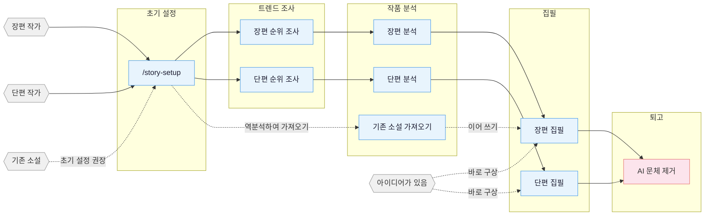

> 원래 영어판의 한국어 번역입니다. 기존 링크의 호환성을 위해 파일명은 유지합니다.

<!-- README.md와 마지막으로 동기화한 날짜: 2026-10-15 -->


<p align="center">
  
</p>

<h1 align="center">Oh Story</h1>

<p align="center">
  <b>기존에 사용하는 코딩 에이전트에서 실행하는 중국 웹소설 집필 스킬 묶음입니다. 순위 조사, 작품 분석, 초안 작성, AI 문체 제거, 표지 제작을 지원합니다.</b>
</p>

<p align="center">
  <a href="https://zenstory.ai/oh-story"><b>프로젝트 페이지</b></a>
  &nbsp;·&nbsp;
  <a href="https://app.zenstory.ai/?utm_source=gh-oh-story-en&utm_medium=readme"><b>웹 워크벤치</b></a>
  &nbsp;·&nbsp;
  <a href="#installation"><b>설치</b></a>
  &nbsp;·&nbsp;
  <a href="#faq"><b>FAQ</b></a>
  &nbsp;·&nbsp;
  <a href="README.md"><b>중국어판의 한국어 번역</b></a>
</p>

<p align="center">
  <a href="https://github.com/zenstory-ai/oh-story-claudecode/stargazers"></a>
  <a href="https://github.com/zenstory-ai/oh-story-claudecode/releases/latest"></a>
  
  <a href="./LICENSE"></a>
</p>

<p align="center">
  <a href="https://t.me/ohstoryclaudecode"></a>
  <a href="https://github.com/zenstory-ai/oh-story-claudecode/discussions"></a>
</p>

<video src="https://github.com/user-attachments/assets/8f9cc11b-1fb8-4cc5-a084-e0deb05ec791" controls muted playsinline width="100%"></video>

<a id="what-it-is"></a>
## 소개

Oh Story는 장편과 단편의 전체 웹소설 제작 과정, 즉 **순위 조사 → 인기작 분석 → 개요와 본문 작성 → AI 문체 제거 → 표지 제작**을 지원합니다. 기존 코딩 에이전트에 14개 스킬을 설치하며, 집필에는 해당 에이전트의 모델을 사용합니다. GPU나 별도의 모델 설정은 필요하지 않습니다.

- **파일 시스템이 바로 ‘메모리’의 역할을 합니다**. 설정 정보, 개요, 본문 내용, 그리고 작업의 연속성에 관한 정보들은 각기 다른 파일에 저장되어 있습니다. 컨텍스트가 압축되거나 세션이 변경되면, 워크플로우는 해당 파일들에서 진행 상황, 단서들, 그리고 미완료된 작업 내용을 다시 불러옵니다.
- **결정적 검사와 검증 관문** — 장편 집필 전에 청사진과 추적 정보를 확인하고, 집필 후에는 글 잘림, 엔지니어링 용어, 흔한 AI 문체를 검사합니다. 훅을 지원하는 호스트는 해당 검사를 자동 실행하고, 다른 환경은 스킬 워크플로를 따릅니다.
- **7개의 코딩 에이전트용 어댑터** — Claude Code · Codex CLI · Google Antigravity · OpenCode · ZCode · OpenClaw · Reasonix. 프로젝트 파일을 읽을 수 있는 일반적인 웹 AI/에이전트 환경에서도 이 스킬들을 사용할 수 있습니다.
- **대상 플랫폼** — 치뎬, 판체, 진장, 치마오, 즈후 옌옌 등 중국의 장편·단편 플랫폼입니다.

> **클리셰 = 감정을 안정적으로 전달하는 수단.**

순위를 **조사**해 장르, 인물, 접근 방향을 파악하고, 인기작의 속도 조절과 플롯 기법을 **분석**한 뒤 훅, 보상, 기대감을 갖춘 자신만의 이야기를 만듭니다. 설정, 본문, 연속성 추적 정보는 별도 파일에 저장합니다. 작가가 방향을 선택하고 에이전트는 합의한 계획에 따라 작업합니다.

<a id="installation"></a>
## 설치

```bash
npx skills add zenstory-ai/oh-story-claudecode -y -g
```

`-g`는 모든 디렉터리에서 사용할 수 있도록 전역 설치합니다. 현재 디렉터리에만 설치하려면 이 옵션을 빼세요. **업데이트할 때도 같은 명령을 다시 실행합니다.**

에이전트에게 요청하는 것도 간단합니다. GitHub 리포지토리나 스킬을 가져올 수 있는 모든 플랫폼, 예를 들어 WorkBuddy 등을 사용하면 됩니다. 자세한 내용은 중국어로 된 [커뮤니티 가이드](https://zhuanlan.zhihu.com/p/2087452622655592204)를 참고하십시오.

```
이 https://github.com/zenstory-ai/oh-story-claudecode 스킬을 설치하세요.
```

그런 다음 집필 프로젝트 루트 디렉터리(Codex에서는 `$story-setup`)에서 `/story-setup`를 실행하여 호스트가 지원하는 훅, 에이전트, 참조 자료들을 배포하고, **새로운 세션을 시작**하세요.

[ClawHub](https://clawhub.ai/)에서도 검색할 수 있습니다. 이 리포지토리에 게시된 내용들은 [ClawHub 인벤토리](.clawhub/publish.json)에 명시되어 있습니다.

> 호스트별 배포 차이점, 알려진 제한 사항 및 설치 관련 문제 해결 방법(Windows `ENOENT`, Antigravity `agy -p`, 남아 있는 디렉터리 등)은 **[호스트 배포 및 설치 문제 해결](docs/hosts_EN.md)**에서 확인할 수 있습니다.
> 버전 및 변경 사항은 [CHANGELOG.md](CHANGELOG.md)과 [Releases](https://github.com/zenstory-ai/oh-story-claudecode/releases)에 명시되어 있습니다. 기존 프로젝트들은 [업그레이드 가이드](skills/story-setup/UPGRADING.md)를 참고하여 진행해 주시기 바랍니다.

<a id="see-what-it-produces"></a>
## 산출물 예시

아래에는 실제 스킬 산출물과 AI 문체를 의도적으로 넣은 테스트 문장이 포함돼 있습니다. 전체 파일은 **[demo/](demo/README_EN.md)**에 있습니다.

<a id="the-continuity-card-keeping-the-current-state-in-files"></a>
### 연속성 카드: 파일 내 현재 상태를 유지하는 기능

아래 소설은 프로젝트 작성자의 창작물입니다. `/story-import`로 이미 공개된 20개 장을 이어 쓸 수 있는 프로젝트로 재구성했습니다. 다음은 **21장 집필 전**의 연속성 카드입니다. `/story-long-write`는 `추적/문맥.md`에서 연속성 요약을 읽습니다. 고정된 7개 절로 구성되며 전체 상한은 12 KiB입니다. 주 세션은 집필자에게 필요한 상태만 골라 전달하고 카드 전체를 프롬프트에 넣지 않습니다. 청사진, 관련 설정, 필요한 인물 카드는 작업에 맞춰 별도로 읽습니다.

```markdown
## 현재 위치
- 제20장 · 제1권 · 이야기 시간: “如愿”이 1억 회의 조회수를 기록한 다음 날

## 고정된 제약 조건들
- 선전 활동의 보상은 작품의 실제 효과, 도달 데이터, 주변 인물의 반응으로 드러나야 하며,
  시스템 알림만으로 처리해서는 안 됩니다.
- 중자자의 공개되지 않은 군 경력은 작가가 아는 진실이며,
  본문에서 공개되기 전까지 독자가 아는 사실로 취급할 수 없습니다.

## 활성 복선
- F016｜중자자는 평범한 인턴 기자가 아니다｜7장에 배치｜회수 시점 미정｜중요도 높음
- F049｜우웨이는 형사 소환장을 받았으나 법적 결과는 아직 나오지 않았다｜18장에 배치｜중요도 높음
- F054｜한 퇴역 군인이 장천에게 자신의 이야기를 들으러 오라고 초대했다 — 후속 작품의 실마리｜20장에 배치｜중요도 높음

## 다음 장을 향한 약속들
- 먼저 21장 청사진을 작성한 뒤 퇴역 군인의 초대, 새 반주곡,
  피아노 능력을 이어서 다룹니다.
```

**작가가 아는 진실과 독자가 아는 사실을 별도로 추적합니다.** 인물이 너무 일찍 정답을 알거나 복선이 이미 공개됐는지 확인하기 위한 것입니다. 전체 파일: [`demo/长篇/.../追踪/上下文.md`](demo/长篇/让你管账号，你高燃混剪炸全网/追踪/上下文.md)

<a id="continuing-into-chapter-21-gate-to-write-back-end-to-end"></a>
### 21장 이어 쓰기: 검증부터 기록 반영까지

위 비디오는 바로 이 세션의 내용입니다. `/story-long-write 写第21章`가 어떤 결과를 만들어냈는지, 그리고 그 과정에서 이루어진 모든 검증 내용이 담겨 있습니다.

```text
Blueprint       상세개요_제021장.md              tracking said "no blueprint for ch.21", so the skill wrote one first: unit L1-03, target emotion, stakes, loop state, a 10-row four-column plot table (plus the optional resolution column)
Chapter check   storyctl.py chapter check   ready · 2068 chars / target 2300
                  ├ check-ai-patterns.js     0 hits
                  ├ check-degeneration.js    0 hits
                  └ normalize-punctuation    0 hits
Tracking commit storyctl.py chapter commit  tracking_committed=true · state_revision 0 → 1
Derived views   tracking_commit.py check    문맥.md / 복선.md / 인물상태/ / 시간선/ / 장별기록/ all re-rendered from state, byte-identical
```

워크플로는 초안을 쓰기 전에 청사진과 추적 정보를 확인합니다. 청사진이 구조 검사를 통과하면 `narrative-writer`가 두 차례에 나눠 본문을 작성합니다. 한 장을 커밋하기 전에 사실과 복선을 검토하고, 일일 일괄 집필에서는 마지막에 남은 장을 검사합니다. 가독성 개선이 필요하면 AI 문체 검토를 추가합니다. 결과를 전달하기 전에 결정적 마무리 스크립트와 `chapter check`를 실행합니다.

커밋 후 추적 상태 전체를 `_tracking-state.json`에서 다시 렌더링합니다. **파생 뷰를 직접 수정하면 `check`가 거부합니다.** 위 카드와 비교했을 때 기록 반영으로 달라진 내용은 다음과 같습니다. 발췌문이므로 최근 장 요약과 인물 스냅샷은 생략했습니다.

```diff
 ## Current position
-- Chapter 20 · Scene: the propaganda troupe, after Zhong Jiajia delivers the veterans' calligraphy
+- Chapter 21 · Scene: the troupe office, after Jiang Chen receives Tan Shouyi's address
 ## Live foreshadowing
-- F054｜A veteran invited Jiang Chen to hear his story｜planted ch.20｜payoff TBD｜high
+- F054｜Tan Shouyi has sent his address; Jiang Chen will visit tomorrow｜planted ch.20｜payoff ch.22｜high
+- F057｜Tan Shouyi has a story "fifty years long that no one has heard to the end"; contents unrevealed｜planted ch.21｜payoff ch.22｜high
+- F058｜Task three: a "farewell" piece, 10M+ heat on open day, 14-day limit｜planted ch.21｜payoff ch.27｜high
 ## Promises for the next chapter
-- Write the ch.21 blueprint first, then pick up the veteran's invitation, the backing track and the piano skill.
+- Jiang Chen asks for leave, travels to the neighbouring city to hear Tan Shouyi's full story and records it; F057 revealed.
 ## Continuity risks
-- Chapter 21 has no blueprint yet; prose cannot be written directly.
+- The truth behind Tan Shouyi's story is a candidate (E015); the author may change it before the ch.22 blueprint; not reader-known until revealed.
```

새 인물 탄수이에게는 별도의 설정 카드와 인물 상태 파일이 생깁니다. 그의 이야기에 숨겨진 진실 후보(E015)는 `시간선/작가용진실.md`에 미공개로 기록하고, `독자가아는사실.md`에는 장천이 읽은 한 줄만 기록합니다. 해소된 위험 항목은 `장별기록/제021장.md`의 해당 장 해제 기록 절에 남깁니다. **상태는 기록 없이 사라지지 않습니다.**

출력: [`正文/第021章_离别怎么会开花.md`](demo/长篇/让你管账号，你高燃混剪炸全网/正文/第021章_离别怎么会开花.md) · [`大纲/细纲_第021章.md`](demo/长篇/让你管账号，你高燃混剪炸全网/大纲/细纲_第021章.md) · [`设定/角色/谭守义.md`](demo/长篇/让你管账号，你高燃混剪炸全网/设定/角色/谭守义.md) · [`追踪/逐章记录/第021章.md`](demo/长篇/让你管账号，你高燃混剪炸全网/追踪/逐章记录/第021章.md)


<a id="a-deconstruction-report-scores-that-come-with-reasons"></a>
### 작품 분석 보고서: 점수와 근거

`/story-long-analyze`로 《반룡》 첫 23장(약 62,000자)을 분석한 결과입니다. 치뎬의 고전 작품을 순수하게 분석 자료로 사용했으며, 판체의 남성향 성장 판타지 독자 취향을 기준으로 평가했습니다.

| 평가 항목 | 점수 | 근거(발췌) |
|------|------|------|
| 도입부 훅 | 2 | 첫 500자는 지리 설명과 아침 훈련 군상 장면뿐이며 서스펜스·갈등·대조가 없습니다. 몰입감은 좋지만 즉각적으로 독자를 끌어당기는 힘은 약합니다. |
| 주인공 | 4 | 이름은 늦게 등장하고(60번째 문단), 타인의 놀라움을 통해 소개됩니다. 몰락한 귀족 가문과 여섯 살 천재라는 대비가 형성됩니다. 첫 세 장에서 가장 강한 요소입니다. |
| 보상 설계 | 1 | 세 장 동안 전형적인 보상이 전혀 없습니다. 몰입감이 쌓일 것을 기대하며 만족감을 18장의 특수 능력 아이템까지 의도적으로 늦춥니다. |

> **종합**: 인물은 강하지만 보상이 전혀 없는 극단적인 구조입니다. 이 도입부를 그대로 따라 하면
> 판체 독자를 잃을 수 있습니다. 다만 멘토를 통한 설명, 이름을 늦게 밝히는 방식,
> 신체 행동으로 결의를 표현하는 방식 같은 개별 기법은 재활용 가치가 높습니다.

전체 보고서: [`demo/拆文库/盘龙/拆文报告.md`](demo/拆文库/盘龙/拆文报告.md)

<a id="short-form-deconstruction-turning-your-own-story-into-reusable-modules"></a>
### 단편 분석: 자기 작품을 재사용 가능한 구성 요소로 만들기

`/story-short-analyze`로 프로젝트 작성자의 단편 《한때 사랑을 감추었다》(약 8,500자, 떠난 아내를 되찾는 이야기와 위장 죽음 장르)를 분석하면 플롯 노드 54개와 기법 기록 11개가 나옵니다. 모든 노드는 원문에 근거하며 감정 유형과 강도(−9~+9)를 표시합니다.

| 원문 | 추출된 구조 |
|---|---|
| “곽 대표님은 아직 심모월 모자를 집에 들이실 생각이 없으신가요?”<br>“그럴 필요 없어. 사생아일 뿐이야.”<br>문을 밀고 들어가려던 나는 그 말을 듣고 허공에서 손을 멈췄다. | **N1 문 앞에서 “사생아일 뿐”이라는 말을 엿듣는다**<br>유형{정보} · 감정{충격}{−7}<br>기법{갈등으로 시작 + 정보 격차} |
| 곽정욱은 나를 사랑하지 않는다.<br>나는 말없이 손을 거두었다.<br>이제 내 집착을 버려야 했다. | **N2 그가 자신을 사랑하지 않음을 받아들이고 놓아주기로 결심한다**<br>유형{감정} · 감정{쓰라림}{−5} |

같은 산출물의 `집필기법.md`에서는 원문의 대가도 짚습니다.

> **시점의 대가**: 남자 주인공의 심경 변화는 장면으로 묘사되지 않습니다. N47의 내적 독백이
> “이미 용서했다, 잠들지 못한다, 깊이 사랑한다”를 한꺼번에 쏟아냅니다. 보여 주지 않고 설명하는 방식은
> 이 장르의 1인칭 소설에서 흔히 나타나는 약점입니다.

`/story-short-write`는 분석 보고서, 플롯 노드, 기법 기록, 원문을 활용해 새 이야기를 구상합니다. 전체 산출물: [`demo/拆文库/曾将爱意私藏/`](demo/拆文库/曾将爱意私藏/)

<a id="de-ai-editing-rule-by-rule-matching"></a>
### AI 문체 제거: 규칙별 패턴 검사

`/story-deslop`의 로컬 검사는 글쓰기 린터입니다. 알려진 문장 패턴을 찾아 줄 번호, 해당 구간, 수정 방향을 제공합니다. AI 문체를 의도적으로 넣은 테스트 문장을 검사하면 8건이 검출되며 그중 7건은 통과를 차단합니다.

```text
改前.md:7:20     [blocking] em-dash             (么叫做命运的安排——不是巧合，而是一)
改前.md:7:22     [blocking] not-is-comparison   (不是巧合，而是一种冥冥之中的注定)
改前.md:11:1     [blocking] negation-parade     (没有犹豫，没有生涩，)
改前.md:19:3     [blocking] voice-contrast      (声音不大，却)
改前.md:21:2     [blocking] not-is-comparison   (不是一次简单的弹奏，而是一场蓄谋已久的惊艳亮相)
改前.md:3:1      [advisory] cliche-density-tic  (仿佛 一丝 深吸一口气 缓缓 微微)
```

21장의 대응 문단에서는 **검출 0건, 종료 코드 0**이 나옵니다. 두 문단의 길이는 거의 같습니다. 첫 문단은 독자에게 느껴야 할 감정을 설명하지만, 두 번째 문단은 같은 장면의 감정을 눈에 보이는 행동과 사물로 전달합니다.

전면적인 비교 및 8가지 주요 결과: **[demo/AI 문체 제거 비교/](demo/去AI味对照/README_EN.md)**

<a id="local-workbench-and-covers"></a>
### 로컬 작업대와 표지

`/story dashboard`(Codex에서는 `$story dashboard`)로 작품 분석 자료와 장편·단편 프로젝트 트리를 탐색합니다. 로컬 작업대는 검색, Markdown 미리보기, 텍스트 편집, 충돌 방지 저장, 확인 후 삭제와 밝은·어두운 테마를 지원합니다. `127.0.0.1`에서만 연결을 받고 소설 내용을 업로드하지 않습니다.

| 작업대 | `/story-cover`의 표지 이미지 |
|---|---|
|  |  |

<a id="your-first-request"></a>
## 당신의 첫 번째 요청

자신의 작업에 가장 적합한 요청 항목을 선택하고 〈대체 문자열〉들을 해당 내용으로 바꾸세요.

1. **새로운 책을 시작해 보세요**
   > 새로운 〈장르/핵심 설정〉의 책을 시작하고 싶습니다. 먼저 자료에서 확정된 사실과 아직 열린 결정을 구분해 주세요. 범위를 한정한 도입부만 계획하고 중심 갈등, 시점과 정보 공개의 한계, 첫 세 장의 변화, 미결정을 정리해 주세요. 본문을 자동으로 쓰지 말고 장르 선택의 장단점, 인물의 동기, 장기 방향은 제가 확인하도록 남겨 주세요.
2. **기존의 원고를 가져오기**
   > 이 원고를 이어 쓸 수 있는 프로젝트로 정리해 주세요. 1~〈N〉장은 완성됐고 〈파일명〉은 〈N+1〉장의 일부입니다. 원문을 보존하고 완성된 장을 덮어쓰지 마세요. 부분 원고를 완성된 장으로 세지 말고, 추론한 설정은 확인 대상으로 구분하세요. 먼저 감지한 범위, 복원한 사실, 모순·모호한 점, 제 확인이 필요한 결정을 검토용으로 제시해 주세요. 아직 이야기를 이어 쓰지 마세요.
3. **불만족스러운 부분을 수정하자**
   > 이 문단은 〈모호함/반복/과도한 설명〉이 느껴집니다. 이야기의 사실, 인물이 아는 정보, 아직 공개되지 않은 정보를 유지하면서 구체적인 읽기 문제를 먼저 짚어 주세요. 이 문단의 수정 제안, 수정 전후 비교, 이유만 제시하고 책 전체를 다시 쓰지 마세요. 채택 여부는 제가 결정하겠습니다.

<a id="pipeline-overview"></a>
## 파이프라인 개요

순위 조사와 작품 분석는 선택 사항입니다. 먼저 구조와 개요에 대해 논의하는 것부터 시작하셔도 됩니다. 본문 파일을 작성하기 전에 먼저 프로젝트를 설정해 두세요.



<a id="skills"></a>
## 스킬

**다음 스킬만으로도 책을 쓸 수 있습니다**. `story-setup`을 한 번 실행한 다음 연재물에는 `story-long-write`, 단편에는 `story-short-write`, AI 문체 정리에는 `story-deslop`을 사용합니다. 어떤 스킬을 호출할지 모르겠다면 `/story` 뒤에 요청을 한 문장으로 적습니다.

| 스킬 | 호출 방법 | 설명 |
|:------|:--------|:------------|
| `story-setup` | `/story-setup` / `$story-setup` | 환경 설정 — Claude/Antigravity/OpenCode/Codex/ZCode/OpenClaw/Reasonix 및 일반적인 설정들(안전한 병합 기능 포함) |
| `story` | `/story` / `$story` / `/story dashboard` | 일반 요청과 작가 선호 요청을 적절한 스킬로 전달하고, 로컬 작품 분석·프로젝트 대시보드 제공 |
| `story-long-write` | `/story-long-write` | 장편 집필 — 개요 구성, 인물 설계, 본문 작성, 작가 선호 관리 |
| `story-short-write` | `/story-short-write` | 단편 집필 — 감정 설계, 반전 구성, 퇴고와 결과 전달, 작가 선호 관리 |
| `story-deslop` | `/story-deslop` | AI 문체 제거 — AI가 쓴 글의 흔적을 탐지하고 수정 |

**추가 기능**: 필요에 따라 비교 작품 분석, 트렌드 조사, 원고 가져오기, 다각도 검토, 출판 정보 준비, 표지 제작을 사용합니다.

| 스킬 | 호출 방법 | 설명 |
|:------|:--------|:------------|
| `story-long-analyze` | `/story-long-analyze` | 장편 작품 분석 — 황금 첫 세 장, 보상 설계, 전개 속도 분석 |
| `story-long-scan` | `/story-long-scan` | 장편 순위 조사 — 치뎬·판체·진장 시장 동향 |
| `story-short-analyze` | `/story-short-analyze` | 단편 작품 분석 — 이야기의 핵심, 구조, 감정 곡선, 반전 설계, 집필 기법, 공감 요소 |
| `story-short-scan` | `/story-short-scan` | 단편 순위 조사 — 즈후 옌옌·판체 단편 인기 데이터 |
| `story-import` | `/story-import` | 역분석하여 가져오기 — 기존 소설을 표준 프로젝트 구조로 정리 |
| `story-review` | `/story-review` | 다각도 원고 검토 — 판체·치뎬·즈후 평가 기준을 적용하는 전체·간소화·단독 모드 |
| `story-publish` | `/story-publish` | 출판 준비 — 기존 설정과 개요를 플랫폼의 작품 등록 정보(제목, 소개, 태그)로 변환. 현재 판체 지원 |
| `story-cover` | `/story-cover` | 표지 프롬프트 또는 이미지 — Codex 기본 사용량의 GPT-Image-2를 사용하며 대안으로 API 호출 |
| `browser-cdp` | `/browser-cdp` | 브라우저 제어 기능 – 재사용 가능한 로그인 세션을 활용한 스크래핑을 위한 CDP 프로토콜 |

> `story-deslop`은 로컬 본문 린터를 사용합니다. 통과 차단은 결정적으로 판정할 수 있는 문체·문장 부호 문제에만 적용하며, 나머지 항목은 실제로 읽고 판단해야 합니다. Zhuque 같은 외부 탐지기는 자체 점검용 참고 자료이며 사람의 검토를 대신하지 않습니다.

자연어로도 호출할 수 있습니다. `帮我开书`(새 책을 시작하도록 도와줘) → `story-long-write`, `整理番茄发布资料`(판체 출판 자료를 정리해줘) → `story-publish`, `这篇太AI了`(이 글은 AI 문체가 너무 강해) → `story-deslop`, `把我的书导进来`(내 책을 가져와줘) → `story-import`, `打开工作台`(작업대를 열어줘) → `story dashboard`, `记住我的写作习惯`(내 집필 습관을 기억해줘) → `story`로 연결됩니다. 마지막 요청은 적절한 집필 스킬로 전달해 작가 메모리를 관리합니다. `沈栀现在什么状态`(선지는 지금 어떤 상태야)라고 물으면 프로젝트 파일을 검색하며, 호스트가 지원하는 경우 `story-explorer`를 사용합니다.

<a id="how-it-works"></a>
## 작동 방식

파일, 전문 에이전트 및 훅은 작성 워크플로우를 지원합니다. 자세한 내용은 **[작동 방식: 에이전트, 훅 및 프로젝트 구조](docs/architecture_EN.md)**를 참조하십시오.

**1. 파일 시스템이 기억입니다** — 장편 소설은 수십만 자에 이릅니다. 설정, 개요, 본문, 추적 정보는 별도 디렉터리에서 독립적으로 관리합니다. 대화는 글을 쓰는 수단이고 기억은 파일에 보관합니다. `추적/_tracking-state.json`이 유일한 구조화된 기준 데이터이며, 여기서 맥락 카드, 복선 뷰, 인물 상태와 작가의 진실·독자가 아는 사실의 이중 시간선을 생성합니다.

**2. 7명의 전문 에이전트** — story-architect는 구조를 담당하고, narrative-writer은 본문을 작성하며, consistency-checker는 내용의 연속성을 확인합니다. 나머지 에이전트들은 등장인물 설정, 자료 조사, 프로젝트 데이터의 추출 및 각 장의 내용 정리를 담당합니다. 프로젝트 에이전트를 지원하는 환경에서는 `/story-setup`가 이들을 배치하며, **배치 후에는 새로운 세션을 시작합니다**. 다른 환경에서는 주 세션 내에서 동일한 작업을 수행합니다.

**3. 집필 전 검증 관문과 집필 후 검사** — 본문 보호기를 지원하는 호스트에서는 대응 개요가 없으면 본문 파일 최초 생성을 차단하고, 추적 체크포인트가 유효하지 않으면 장편 본문 작성을 차단합니다. 집필 후 검사는 글 잘림과 흔한 AI 문체를 탐지합니다. 결정적 차단 항목이 있으면 장 검사를 통과할 수 없습니다. 호스트별 훅, 알림, 대체 동작은 [호스트 배포 세부 정보](docs/hosts_EN.md)를 참조하세요.

각 스킬은 현재 수행 중인 작업에 필요한 `references/`를 로드합니다. 읽지 않은 참조 자료는 어떠한 컨텍스트도 소모하지 않습니다. 전체 주제 목록은 **[지식 베이스](docs/knowledge-base_EN.md)**에서 확인할 수 있습니다.

<a id="supported-platforms"></a>
## 지원되는 플랫폼

**장편** 치뎬 · 판체 소설 · 진장 문학성 · 치마오 소설 · 츠웨이마오

**단편** 즈후 옌옌 스토리 · 판체 단편 · 치마오 단편

실제 산출물은 [demo/](demo/)에서 볼 수 있습니다. 단편 분석 《한때 사랑을 감추었다》, 장편 분석 《반룡》, 장편 이어 쓰기 《계정 관리를 맡겼더니 뜨거운 혼합 편집 영상으로 인터넷을 뒤흔들었다》, 표지 예시 《검도독존》이 포함돼 있습니다.

구직 전환기를 헤쳐 나가는 데 도움을 받고자 이 스킬 묶음을 만들었습니다 :joy:. 다른 분들에게도 도움이 되길 바랍니다.

## FAQ

<a id="does-it-work-in-codex-google-antigravity-or-opencode-or-only-in-claude-code"></a>
### 코덱스, Google Antigravity, OpenCode에서도 작동하나요, 아니면 Claude Code에서만 작동하나요?

oh-story-claudecode는 Claude Code, Google Antigravity, OpenCode, ZCode, OpenClaw, Codex CLI, Reasonix용 어댑터를 제공합니다. Codex는 리포지토리에 있는 `.agents/skills`을 스캔하여 14개의 스킬을 검출한 후 `$story-setup`를 사용하여 이들 스킬을 호출합니다. Antigravity에서는 `/skills` 또는 자연어를 통해 `story-setup`을 실행하며, 현재 호스트 정보(`target_cli=antigravity`)는 자동으로 감지됩니다. OpenCode은 2.x 버전이 필요한데, 이는 1.x 버전에서는 prose-guard 플러그인을 로드할 수 없기 때문입니다. 프로젝트 파일을 읽을 수 있는 모든 웹 AI나 에이전트 환경에서는 이러한 일반적인 스킬 사용 방식을 활용할 수 있습니다.

<a id="do-i-need-a-gpu-or-to-host-a-model"></a>
### GPU가 필요하거나 모델을 직접 호스팅해야 하나요?

oh-story-claudecode는 기존 코딩 에이전트에서 실행하는 스킬 묶음입니다. 집필에는 해당 에이전트의 모델을 사용하고 로컬에서는 결정적 검사 스크립트(Node/Python)만 실행합니다. 예외는 `story-cover`로, Codex 기본 사용량이나 대체 API 호출을 통해 GPT-Image-2를 이용합니다.

<a id="chapter-lengths-are-inconsistent-or-the-word-count-is-off-what-do-i-do"></a>
### 장의 분량이 일관되지 않거나 단어 수가 맞지 않습니다. 어떻게 해야 할까요?

v0.7.7부터 장편 본문은 하나의 기계 계수 기준으로 분량을 계산합니다. 각 장의 청사진에 유효한 목표 글자 수를 반드시 명시해야 하며, 누락되면 3,000자로 대체하지 않고 중단합니다. 분량이 짧다고 새 플롯을 덧붙이지 않으며, 너무 긴 장은 최대 한 번만 압축합니다. 전달 전에 집필 워크플로에서 한 번 계수하고, 집필 후 훅에서는 분량 부족을 더 이상 표시하지 않습니다. 이전 프로젝트를 업그레이드했다면 `/story-setup`을 다시 실행하고 새 세션을 시작하세요.

<a id="after-de-ai-editing-detectors-such-as-zhuque-still-flag-the-text-as-ai-why"></a>
### AI 문체 제거 후에도 Zhuque 같은 탐지기가 AI 글로 판정하는 이유는 무엇인가요?

`story-deslop`(`/去AI味`)는 로컬 스크립트로 알려진 문장 패턴, 문장 부호 습관, 퇴화 흔적을 탐지합니다. 에이전트가 문맥을 검토하고 문단을 고쳐 가독성을 개선하며, 외부 탐지기는 자체 점검에 참고합니다. [구체적인 수정 안내](https://zenstory.ai/oh-story/revise-ai-prose)는 장면의 역할과 작가가 정한 사실을 유지하면서 모호한 감정, 반복 구문, 근거 없는 해설, 과도한 설명을 구분합니다. 저장소의 작동 방식은 [AI 문체 제거의 구체적인 방법](docs/how-to-remove-ai-flavor-from-web-fiction.md)에 설명돼 있습니다.

<a id="i-already-have-part-of-a-novel-written-can-i-import-it-and-continue"></a>
### 저는 이미 소설의 일부를 써두었습니다. 이 부분을 가져와서 계속 집필해도 될까요?

네. 프로젝트 루트에서 `/story-setup`을 실행하고 세션을 새로 시작하거나 갱신합니다. `/story-import`로 기존 소설을 역분석해 표준 프로젝트 구조로 정리하고 추론 결과를 검토한 뒤 `/story-long-write 写第N章`으로 이어 씁니다. N은 가져온 범위 다음의 첫 장이며 먼저 해당 장의 개요를 작성합니다. 단편은 `/story-short-write`에 “구상을 완성해줘”라고 요청해 기획을 마친 뒤 이어 씁니다. [가져온 원고 이어 쓰기 안내](https://zenstory.ai/oh-story/import-and-continue)는 원고의 근거를 모델의 추측보다 우선해야 하는 이유를 설명합니다.

<a id="how-do-i-reduce-forgotten-clues-or-characters-knowing-answers-too-early-in-a-long-continuation"></a>
### 장편을 이어 쓸 때 단서를 잊거나 인물이 정답을 너무 일찍 아는 문제를 줄이려면 어떻게 하나요?

이어 쓰기 전에 객관적인 이야기의 사실, 인물이 아는 정보, 독자가 이미 본 내용을 구분하세요. 해당 장에 필요한 현재 상태와 미완료 약속만 전달합니다. [장편 연속성 안내](https://zenstory.ai/oh-story/long-novel-continuity)는 세 장 분량의 예시를 제공하고, [100장 이상 AI 소설의 일관성 유지하기](docs/keep-ai-novel-consistent-over-100-chapters.md)는 이 저장소의 연속성 추적 방식을 설명합니다.

<a id="my-chapter-outline-is-complete-why-does-the-prose-still-summarize-the-setup"></a>
### 제 챕터 개요는 이미 완성되었는데, 왜 본문 부분에서 여전히 설정 부분이 요약되어 있는 걸까요?

개요를 반드시 변경해야 할 사항들에 대한 지침으로 간주하고, 그 개요에 포함된 목표, 장애물, 증거, 선택 사항 및 비용 등을 관점 인물이 인식할 수 있는 구체적인 행동과 결과로 전환시켜야 합니다. [개요를 본문으로 옮기는 안내](https://zenstory.ai/oh-story/outline-to-chapter)에서는 이러한 접근 방식을 실제 사례를 통해 자세히 설명하고 있습니다.

<a id="how-do-i-keep-my-voice-without-carrying-plot-facts-over-from-another-book"></a>
### 다른 책의 줄거리 사실을 가져오지 않고 내 문체를 유지하려면 어떻게 하나요?

직접 썼거나 사용 허가를 받은 짧은 예문의 문체 특성을 현재 책의 사실과 구분해 설명하세요. 예문에서 추론했다고 지속적인 선호로 자동 등록되지는 않습니다. [작가 문체 안내](https://zenstory.ai/oh-story/preserve-author-voice)는 현재 요청, 책의 문체, 작가 선호를 조율하는 방법을 설명합니다. 예문은 표현을 참고하는 용도로만 사용하고 문장을 그대로 복사하지 마세요.

<a id="on-windows-the-install-prints-enoent--mkdir-but-ends-with-done-is-that-normal"></a>
### 윈도우에서 설치를 진행하면 ‘`ENOENT ... mkdir`’이라는 메시지가 출력된 후 ‘완료’라는 메시지가 나타납니다. 이것이 정상인가요?

일부 스킬이 완전히 설치되지 않았다는 뜻입니다. 오류 표시 여부와 관계없이 같은 설치 명령을 다시 실행하면 복구됩니다. 참조 자료 디렉터리가 누락되면 `/story-setup`이 불완전한 참조 묶음으로 보고합니다. Windows의 Codex 사용자는 Git의 `core.symlinks`도 활성화해야 합니다.

<a id="what-do-i-do-after-upgrading"></a>
### 업그레이드한 후에는 어떻게 해야 하나요?

스킬 묶음을 업데이트한 뒤에는 새 세션을 시작하세요. 프로젝트 에이전트, 훅, 참조 묶음이 바뀌었거나 코딩 에이전트를 변경했다면 프로젝트 루트에서 `/story-setup`을 다시 실행한 뒤 새 세션을 시작하세요. 버전별 요구 사항은 [업그레이드 안내](skills/story-setup/UPGRADING.md)를 확인하세요.

<a id="what-is-the-difference-between-the-short-form-and-long-form-entry-points"></a>
### 단편과 장편의 진입점은 어떻게 다른가요?

장편: `/story-long-scan`(순위 조사) → `/story-long-analyze`(작품 분석) → `/story-long-write`(전체 개요, 권별 개요, 장별 청사진, 본문). 단편: `/story-short-scan` → `/story-short-analyze` → `/story-short-write`. 양쪽 모두 `/story-setup`, `/story-deslop`, `/story-review`, `/story-cover`를 공유합니다.

<a id="further-reading"></a>
## 더 자세한 정보를 원하시면…

- [프롬프트, 스킬 묶음, 플러그인, MCP](https://zenstory.ai/oh-story/agent-skills-for-writers) — 호스트와 워크플로보다 먼저 수행할 집필 작업을 선택하세요.
- [10~20장을 먼저 가져와서 작업을 계속하십시오](https://zenstory.ai/oh-story/import-and-continue) — 추론된 구조를 검토하고, 원고를 증거로 간주하십시오.
- [인물의 지식, 약속, 복선 구분하기](https://zenstory.ai/oh-story/long-novel-continuity) — 미래 계획을 과거 사건으로 취급하지 마세요.
- [플롯의 구성 사항을 명확하게 기재하십시오](https://zenstory.ai/oh-story/outline-to-chapter) — 행동, 선택, 비용, 결과 등의 요소를 순서대로 고려하십시오.
- [구체적인 편집을 통해 “AI 같은” 문장 스타일을 줄이기](https://zenstory.ai/oh-story/revise-ai-prose) — 이는 검출기의 점수를 높이기 위함이 아니라, 독서 경험을 개선하기 위한 것입니다.
- [문체 선택과 작품의 사실 구분하기](https://zenstory.ai/oh-story/preserve-author-voice) — 사용 허가를 받은 예문을 활용하되 문구를 베끼지 마세요.
- [100개 이상의 챕터에 걸쳐 AI가 작성한 소설의 일관성을 유지하는 방법](docs/keep-ai-novel-consistent-over-100-chapters.md) — 저장소 문서
- [코딩 이외의 Claude Code 스킬: 소설 집필 묶음으로 살펴보기](docs/claude-code-skills-for-writers.md) — 저장소 문서
- [AI 문체 제거의 구체적인 방법](docs/how-to-remove-ai-flavor-from-web-fiction.md) — 저장소 문서
- [순위 조사 및 작품 분석의 자동화 방법](docs/scan-charts-and-deconstruct-bestsellers.md) — 저장소 문서

<a id="contributing"></a>
## 기여하기

새로운 스킬, 지식 베이스의 내용 추가, 시장 데이터의 업데이트 등 어떠한 기여도 환영합니다. 자세한 내용은 [CONTRIBUTING.md](CONTRIBUTING.md)을 참조하십시오.

<a id="community"></a>
## 커뮤니티

- **Telegram**: <https://t.me/ohstoryclaudecode> — 채팅, 문제 해결 및 기능에 대한 논의.
- **GitHub 토론**: [질문을 하거나 도움을 받고, 작업 방식을 공유하세요](https://github.com/zenstory-ai/oh-story-claudecode/discussions).
- **GitHub 이슈**: [버그, 산출물 품질 관련 사례 및 기능 요청사항](https://github.com/zenstory-ai/oh-story-claudecode/issues/new/choose). 구조화된 양식을 사용하고, 문제를 재현할 수 있는 증거나 구체적인 결과 샘플을 함께 제공해 주세요.

<a id="contributors"></a>
## 기여자

<a href="https://github.com/zenstory-ai/oh-story-claudecode/graphs/contributors"></a>

<a id="acknowledgments"></a>
## 감사의 말

- [LINUX DO – 새로운 이상적인 커뮤니티](https://linux.do) — 커뮤니티 지원
- [FanqieRankTracker](https://github.com/wen1701/FanqieRankTracker) — 판체 소설 글꼴 난독화 해독 참고 자료
- [Zhuque AIGC Detector CLI](https://github.com/Sophomoresty/zhuque) — AI 문체 제거 실험의 외부 재검사 도구

<a id="part-of-zenstory-ai"></a>
## ZenStory AI의 일부

Oh Story는 이야기를 창작·각색·제작하는 에이전트용 오픈소스 도구 모음인 [ZenStory AI](https://zenstory.ai)의 일부입니다(GitHub 조직: [zenstory-ai](https://github.com/zenstory-ai)). 관련 프로젝트:

| 프로젝트 | 주요 기능 |
| --- | --- |
| [oh-story-claudecode](https://github.com/zenstory-ai/oh-story-claudecode) | 웹픽션 작성 스킬 팩(이 저장소) |
| [drama-skills](https://github.com/zenstory-ai/drama-skills) | AI 숏드라마·모션 코믹 제작: 대본, 에셋, 스토리보드, 이미지·영상 프롬프트, 독립 검토 |
| [novel-to-game](https://github.com/zenstory-ai/novel-to-game) | 원작에 근거한 소설 각색, 대상 실행 환경 빌드, 증거 기반 품질 검증을 위한 에이전트 스킬 |
| [video-recap-skills](https://github.com/zenstory-ai/video-recap-skills) | 지원하는 영상 파일로 중국어 내레이션 요약 영상을 제작하고, 선택적으로 JianYing/CapCut 편집용 초안 내보내기 |
| [oh-story-dsh](https://github.com/zenstory-ai/oh-story-dsh) | 소설·숏드라마·게임·영상 요약 작업대를 제공하는 커뮤니티 DeepSeek Harness 플러그인 |
| [zenstory](https://github.com/zenstory-ai/zenstory) | 대화로 창작하는 AI 소설 집필 작업대 ([app.zenstory.ai](https://app.zenstory.ai)) |
